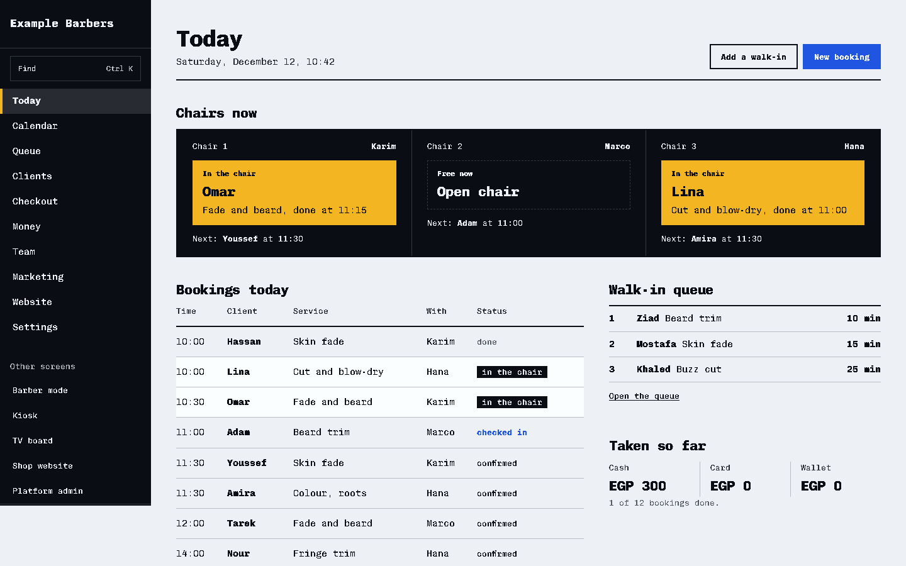
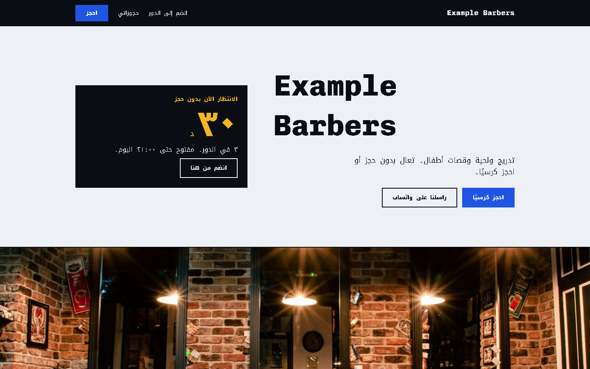
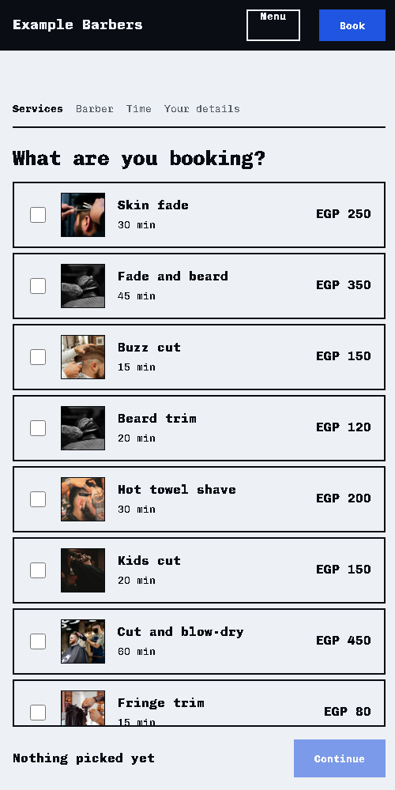
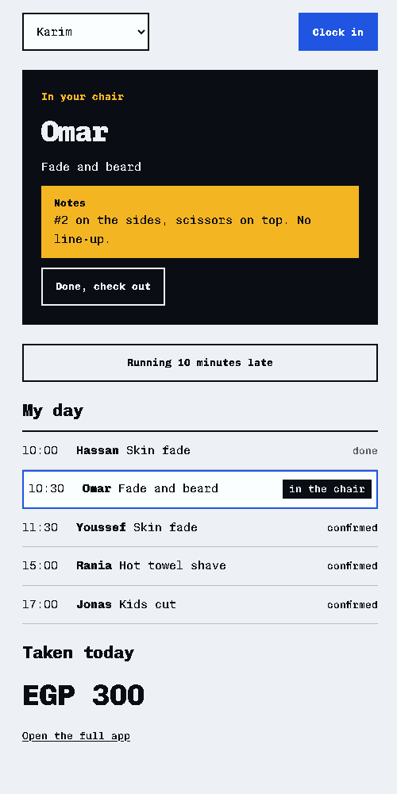
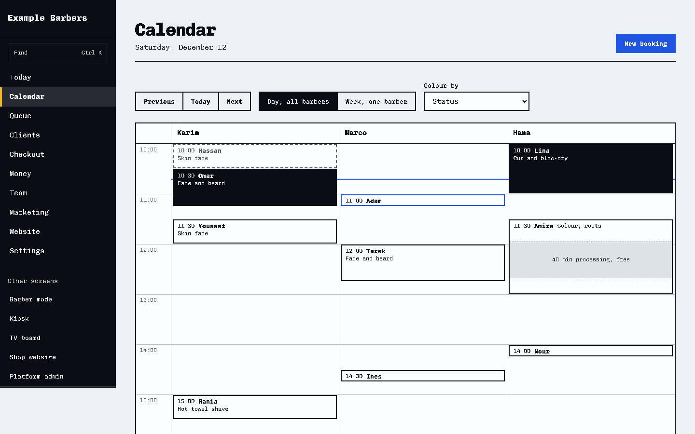
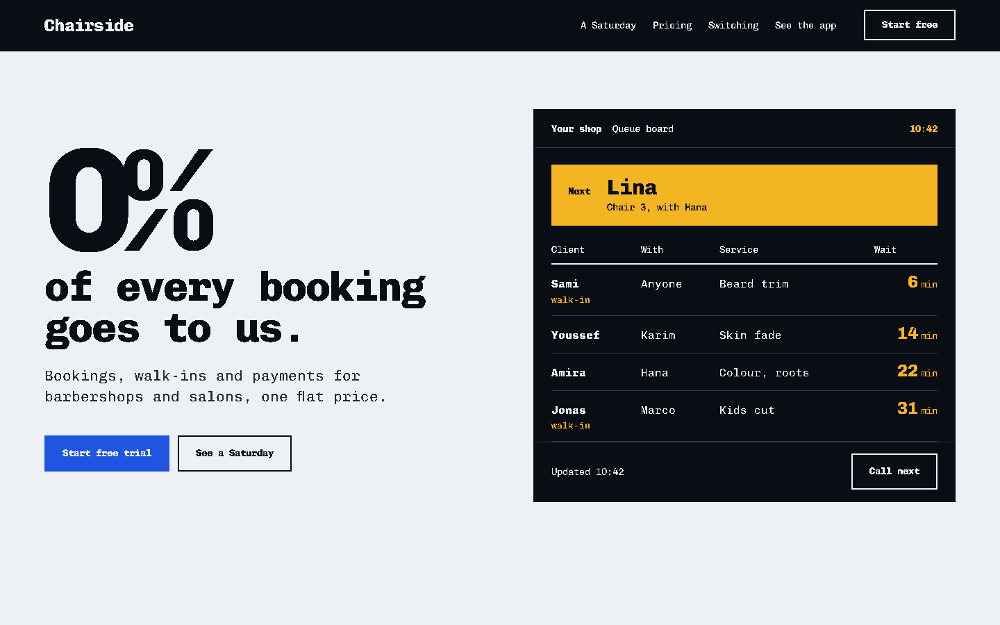

# Chairside

**Booking, walk-in queue and shop management for barbershops and hair salons, built for shops outside the usual US and UK markets.**

Chairside is a SaaS product I am designing and building: a booking page for each shop, a walk-in queue with a TV board, a front-desk app, and a phone view for barbers. It is meant for markets that most booking apps serve poorly: Egypt, Tunisia and southern Europe, where walk-ins matter as much as appointments, Arabic needs right-to-left layout, and shops will not pay a commission on every booking.

This repository is the **frontend**: about 10,000 lines of TypeScript and React, every screen working on sample data in the browser. The backend design (Postgres with row-level security per shop, a booking engine with exclusion constraints, payment adapters per country) is written up in [PLAN.md](PLAN.md) and comes next.



## What it does

| | |
| --- | --- |
| **Shop website and booking** | Each shop gets its own page with a choice of 3 designs, its services and prices, team, photo gallery and hours, plus a 4-step booking flow designed for phones first. It can be embedded on the shop's own site. |
| **Walk-in queue** | Clients join from a QR code, a kiosk tablet at the door or the website. A board on the shop's TV shows who is next, with an estimated wait. |
| **Calendar** | Day view with a column per barber, week view per barber, drag to move a booking. Colour services leave processing time free for other clients, and buffer time before and after a service is kept clear. |
| **Front desk** | Checkout with split payments, tips, promo codes and gift cards; refunds; an end-of-day cash count. |
| **Clients** | Visit history, haircut notes shown on the barber's phone, CSV import from other apps with duplicate matching, before and after photos (only with the client's agreement), and blocking a number from online booking. |
| **Team and money** | Commission or chair rent per barber, payroll summary, time off, a grid of what each role is allowed to do, sales by service and by barber, chair utilisation, profit and loss. |
| **Marketing** | Offers, loyalty punch cards, packages, memberships, and WhatsApp campaigns that leave out clients who did not agree to receive them. |
| **Barber mode** | A phone view for each barber: the next client with their notes, my day, takings so far. It keeps working offline once loaded. |

## Screenshots

| Shop website in Arabic, right to left | Booking on a phone | Barber mode |
| --- | --- | --- |
|  |  |  |

| Calendar | Marketing site |
| --- | --- |
|  |  |

## Engineering highlights

- **Internationalisation from the first line.** All interface text comes from typed catalogues: about 900 strings for the staff app, and English, Arabic and French for everything clients see. Counts use `Intl.PluralRules`, so Arabic gets all six plural forms ("دقيقتان", "٥ دقائق", "١٥ دقيقة"). The CSS uses logical properties only, so Arabic switches to right to left without a separate stylesheet. A test fails if any language is missing a key, a placeholder or a plural form, or if a string is no longer used.
- **Money and time handled correctly.** Amounts are stored in minor units, with each currency's own decimals: the Tunisian dinar has 3, which catches the usual `× 100` bug. Times are always shown in the shop's time zone. Currency, time zone, week start and tax change together from one country setting.
- **A slot finder that knows how hair salons work.** It is a frontend stand-in for the booking engine. Multi-service bookings, a colour's processing time (the stylist is free while it develops), buffer time before and after, minimum notice, and "anyone free" are covered by unit tests.
- **Every data region has four states.** Loading, empty, error and full, each viewable with `?state=` in the URL. Error pages have their own message for being offline.
- **Accessibility treated as a requirement.** Every interactive element has a visible focus style, tap targets are at least 44px, animation respects `prefers-reduced-motion`, there is no colour without a token, and every image has alt text or is marked decorative.
- **Photos without a backend.** Uploads are scaled down in the browser with a canvas before they are kept. Shop gallery photos and client before and after photos can only be added after a consent tick.
- **A locked design system.** The tokens, type and rules in [DESIGN.md](DESIGN.md) are checked with a linter. The project rules are in [CLAUDE.md](CLAUDE.md).

## Tech stack

React 18 · TypeScript 5 (strict) · Vite 5 · React Router 6 · Vitest · plain CSS with design tokens · a service worker for barber mode offline

There is no UI framework and no CSS framework: the component kit is small enough to own ([src/ui/kit.tsx](src/ui/kit.tsx)).

## Run it

Node 18 or later.

```bash
npm install
npm run dev        # http://localhost:5173
npm test           # slot finder, money, time zones, CSV reader, translation catalogues
npm run build      # type-check, then a production build in dist/
```

Then open:

| URL | Screen |
| --- | --- |
| `/` | Marketing site, with `/pricing` (prices by region), `/switch` and `/help` |
| `/app` | Business app: today, calendar, queue, clients, checkout, money, team, marketing, website, settings |
| `/s/example-barbers` | The sample shop's website, booking flow, queue and manage-booking pages |
| `/me` | Barber mode (best on a phone) |
| `/kiosk`, `/tv` | Walk-in tablet and TV queue board |
| `/account` | A client's account (any 6 digits sign in) |
| `/setup` | New-shop setup wizard |
| `/admin` | Platform admin |

Everything runs on sample data (Example Barbers, Cairo, prices in EGP). Changes are kept in your browser; **Reset sample data** at the foot of the app sidebar restores it. Nothing is sent anywhere: messages, payments and sign-in codes are not connected yet, and every screen that would send something says so.

## Project layout

```
src/
  site/        marketing pages, prices by region
  app/         business app screens, staff catalogue (i18n.ts, locales/)
  shop/        shop website, booking flow, queue, manage booking
  account/     client account
  modes/       barber mode, kiosk, TV board
  admin/       platform admin
  lib/         store, slot finder, money and time formatting, client catalogue, plurals, photos
  ui/          component kit and error pages
docs/          screenshots
public/sample/ sample photos (Unsplash, credited in CREDITS.md)
```

## Status and roadmap

| Area | State |
| --- | --- |
| Frontend: every screen in the plan | Built, running on sample data |
| Backend: Postgres with row-level security, booking engine, auth with one-time codes | Designed in [PLAN.md](PLAN.md), next |
| WhatsApp reminders, online deposits (Stripe, Paymob, Konnect), fiscal receipts | Planned, country by country |

The full plan (competitor research, features, architecture, data model, pricing, go-to-market and risks) is in [PLAN.md](PLAN.md).

## Credits

Sample photos are from [Unsplash](https://unsplash.com) under the Unsplash License; each one's source is listed in [public/sample/CREDITS.md](public/sample/CREDITS.md). All names, phone numbers and figures in the sample data are made up.
